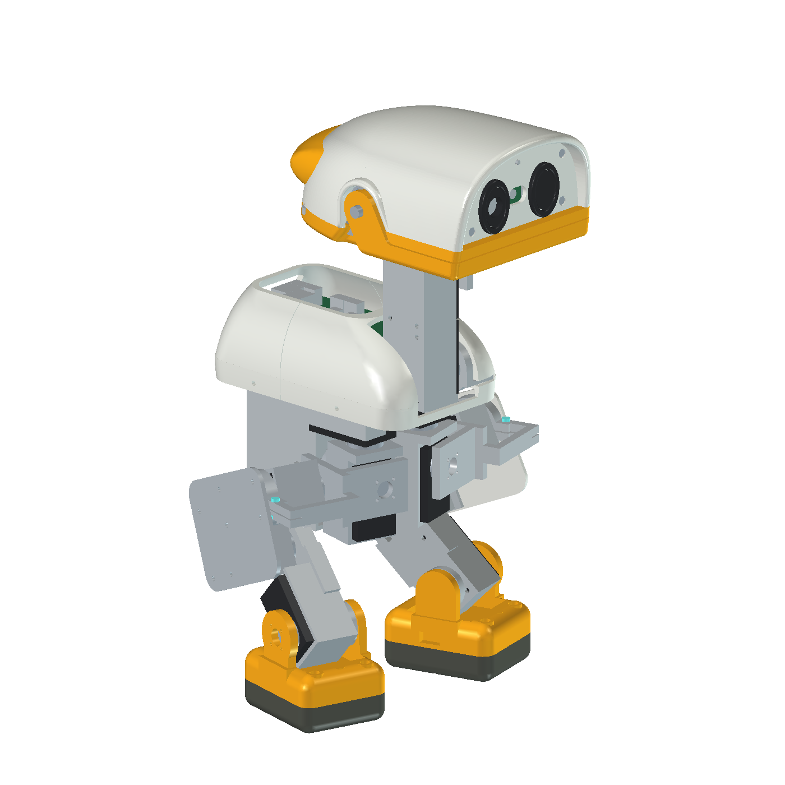

# IndieDuck by Armature AI Labs

The current design is **R25**, a reference-driven exterior on the R20 mechanism: a tapered helmet with a recessed dark camera face, orange optical rings and rims, shoulder-faceted torso with orange inlays, forward hip cowls, slotted thigh caps, shin caps and faceted feet with white toe caps. Adapted from Open Duck Mini and inspired by Pollen Robotics' MicroDuck. Servo and joint positions are unchanged from R20. Reused third-party geometry is identified in [THIRD_PARTY_NOTICES.md](THIRD_PARTY_NOTICES.md).

R25 is a **design-review CAD candidate, not a manufacturing release**. The previous complete release, R20, remains in this repository and at tag `r20-simulation-study-v1`.

**Credits.** [Zankar Savalia](https://www.linkedin.com/in/zankarvs/) contributed to the design of the R25 exterior and helped prepare it for publication. Thank you, Zankar. See [CONTRIBUTORS.md](CONTRIBUTORS.md).

## R25 files

| Path | Contents |
|---|---|
| `native/robot/IndieDuck_R25_Assembly.FCStd` | Complete R25 robot in its saved pose, FreeCAD 1.1.4, self-contained. Each part stores a `MovingBody` property naming the joint link it moves with. |
| `exports/R25/step/`, `exports/R25/stl/` | 51 printed-component candidates, STEP and STL, in assembly coordinates (millimetres) |
| `exports/R25/IndieDuck_R25_Assembly.step` | Full assembly, 161 solids including purchased-part reference envelopes |
| `exports/R25/print-oriented/R25_HelmetLower_upside-down.stl` | HelmetLower in its print orientation (see below) |
| `previews/R25-*.png` | Actual CAD views: assembly, front, side, rear |
| `validation/R25-fixes.json`, `validation/R25-export-readback.json` | Changes made for publication and the export readback checks |
| `COMPONENTS.csv` | R25 rows map every printed component to its native object, material and exports; R20 rows are kept |

**Editing.** The R25 FreeCAD file holds solid geometry without construction history for the new exterior parts. R20's four native documents (below) remain the editable source with history for the retained mechanism. Edits to R25 exterior parts are direct solid edits for now.

## Changes made for publication (13 October 2026)

- **Neck clearance.** The R25 candidate's narrower torso neck opening collided with both neck servos at almost every neck angle. TorsoFront now has a 1 mm swept clearance channel, the trunk a matching relief, and the neck link a small trim where it passed the right hip-yaw servo. The neck is clear of every other part at every 2.5° step from **−65° (chin tuck, as used by the forward roll) to +27.5° (head back)**, simulator convention, axis (0, −1, 0). The head-back limit is set at +27.5° because the head base sweeps across the rear torso beyond it. The simulator currently allows −90° to +60°; it will be narrowed to this range in the next simulator update.
- **HelmetLower print orientation.** Its bottom edge follows the head base contour, so it has no flat underside and the slicer rejects it as exported. Print it **upside down** on its flat top edge; only five internal screw bosses, hidden inside the helmet, want support.

## Printing (provisional)

Sliced in Bambu Studio 2.08 for a Bambu Lab P2S, 0.4 mm nozzle, 0.20 mm layers, 3 walls, 20 % infill: 39 parts on seven plates, about **360 g PLA and 34 g TPU 95A, roughly 16½ hours**. The retained R20 head base, thighs, yaw links, head brackets and cradles are extra. White, orange and dark are appearance colours; use PLA for rigid parts and TPU 95A for the soles. Keep the four HelmetRoof, HelmetLower, FaceBezel and CameraCarrier parts on two plates; Bambu silently dropped one part when all four shared a plate.

## R25 limits

Not yet resolved: camera module choice and its fit; a fastener bill of materials (cowls and toe caps have aligned screw provisions, lengths unconfirmed); retention for the 1 mm optical rings and the small torso inlays; printer-specific clearances on trim parts; strength of the added hip and shank mounts; real mass and balance. The exterior adds material: 482 cm³ of printed CAD volume against 434.5 cm³ for the earlier mechanical candidate. Checked: static clearance of every part, the neck range above, and the forward-roll tuck pose. Not checked: head yaw or roll combined with neck pitch, leg motion with the new covers, jaw motion with the jaw surrounds, cables, physical fit. The browser assembly guide and simulator still show R20 until their R25 update.

## Previous release: R20

A complete **R20 robot CAD study**, with the removable rear colour band integrated into the assembled robot. Adapted from Open Duck Mini and inspired by Pollen Robotics' MicroDuck, with reused XGO geometry identified in [THIRD_PARTY_NOTICES.md](THIRD_PARTY_NOTICES.md).

Armature's changes include compact joint supports, a two-eye face, local head-yaw clearance and a separately printable colour band. This repository contains the mechanical CAD only; runtime and reinforcement learning remain in [indieduck-runtime](https://github.com/armature-ai-labs/indieduck-runtime) and [indieduck-rl](https://github.com/armature-ai-labs/indieduck-rl).

### Explore and assemble

Open the [interactive R20 assembly guide](https://armature-ai-labs.github.io/indieduck/) for component selection, exploded views and assembly steps. The [R20 simulator](https://armature-ai-labs.github.io/indieduck-rl/) is a separate physics study. The guide uses the saved CAD assembly; it does not simulate a physical installation process.

The `assembly/` bundle provides revisioned, labelled display meshes and component records generated from this CAD. These are presentation assets, not additional printable parts. Use the native sources and `exports/` for mechanical editing and printing. Steps and hardware envelopes marked provisional require confirmation during the physical build.

### Open the robot

Download and extract the entire release ZIP, then open **`native/robot/IndieDuck_R20_Assembly.FCStd`** in FreeCAD 1.1.4. Keep these four sibling files together so relative links resolve:

| File | Purpose |
|---|---|
| `IndieDuck_R20_Assembly.FCStd` | Complete robot in its saved standing pose, including the mounted band |
| `IndieDuck_R20_Structure.FCStd` | Structural parts, covers, face, feet and retained construction history |
| `IndieDuck_R20_Interfaces.FCStd` | Joint carriers, clamps, retainers and hardware references |
| `IndieDuck_R20_HeadBand.FCStd` | Editable band profiles, attachment features and mounting-hole head shell |

Edit the source documents rather than presentation snapshots. Older feature names such as `R17_HeadPitch` remain stable identifiers inside R20; they do not indicate that an older assembly must be downloaded. Hidden construction objects are retained where they support editing and provenance. They are not additional parts to print.

The assembly's `YawMotion` spreadsheet accepts a plain number in cell B1, for example `-90`, `0` or `90`. This is a head-yaw study control, not a general pose editor or a guarantee of physical travel. Restore `0` for the default saved view.

### Files and colours

- `exports/`: matching R20 STEP and STL files for the 41 current printed-component candidates, plus the assembled STEP. Purchased servos, electronics, bearings and metal fasteners remain assembly references, not printed-component exports.
- `previews/`: actual assembled and inspection CAD views.
- `drawings/`: applicable review drawings. Inherited sheets retain their original revision labels; they are not a complete dimensioned manufacturing drawing set.
- [COMPONENTS.csv](COMPONENTS.csv) maps every current printed component; [MANIFEST.json](MANIFEST.json) and [SHA256SUMS](SHA256SUMS) identify the packaged files and their source objects. Keep native files and exports from the same release together.

Geometry uses **millimetres**. Individual exports retain their native CAD coordinates; they are not arranged on a build plate or sliced. Colour in the CAD is an appearance setting, not a material specification. Use PLA for initial rigid fit tests and TPU 95A for soles and lips. Bambu Studio can prepare printer-specific jobs after orientation, supports, nozzle and material profiles are checked.

Print the rear band separately in any desired colour. Multicolour printing is not required. The band covers the retained head reinforcement and is attached using two internal screws and captive nuts. Remove the head shell for screw access; the nuts load through the band's underside slots. It is tool-removable, not a snap-on accessory.

The **M2×10 screw with a nominal 0.5 mm washer** is a provisional stack, not a confirmed hardware specification. In the centre-line CAD stack it leaves about 0.492 mm screw-tip space; a bare 10 mm screw reaches the blind end. Confirm printed nut fit, screw length, head seating and tool access before tightening. The band is decorative, not a handle or impact bumper.

### Prototype limits

“Complete” means the current robot assembly and its current printed-component CAD are packaged together. CAD reopening, link checks, solid checks and export checks are distinct from physical fit, slicing, strength and motion tests. Read [VERIFICATION.md](VERIFICATION.md) for the exact checks performed on this release.

A band mesh/CAD volume discrepancy and a smaller assembled STEP volume discrepancy remain recorded in [VERIFICATION.md](VERIFICATION.md). Inherited neck-motion collisions remain unresolved. Combined head motion, cable routing, full band-removal travel, printed tolerances, bearing preload, fastener engagement and structural loads require further work. No trained walking, impact resistance or reproducible physical build is claimed by this release.

See [CONTRIBUTING.md](CONTRIBUTING.md) for changes. Source-specific attribution, applicable licences and unresolved redistribution terms are collected in [THIRD_PARTY_NOTICES.md](THIRD_PARTY_NOTICES.md); this mixed-source collection is not covered by a blanket Apache-2.0 grant.
